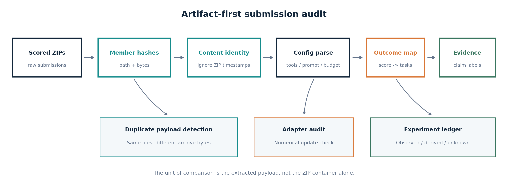
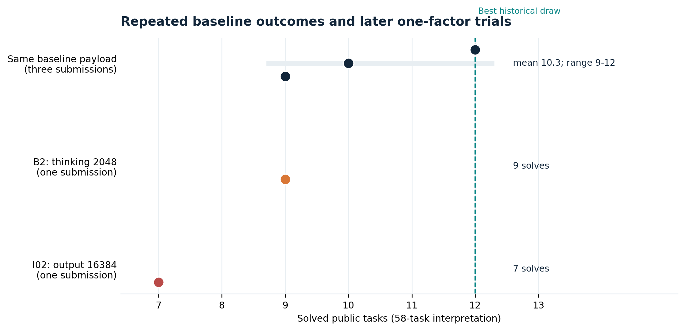
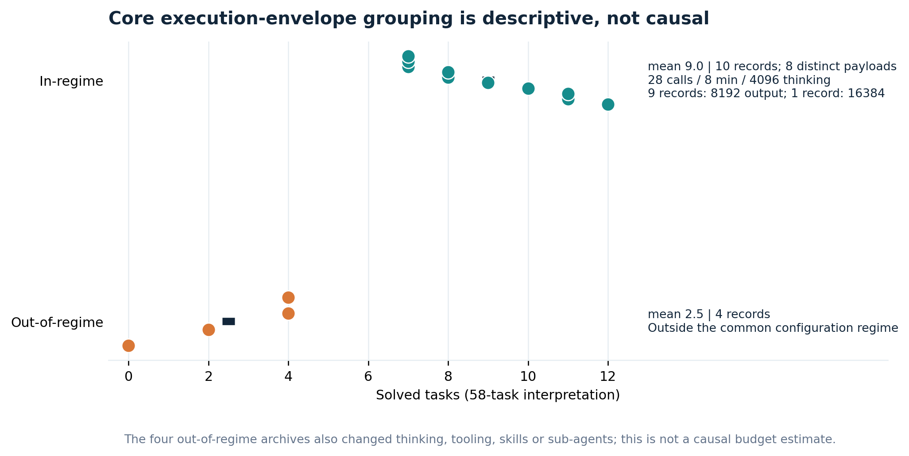
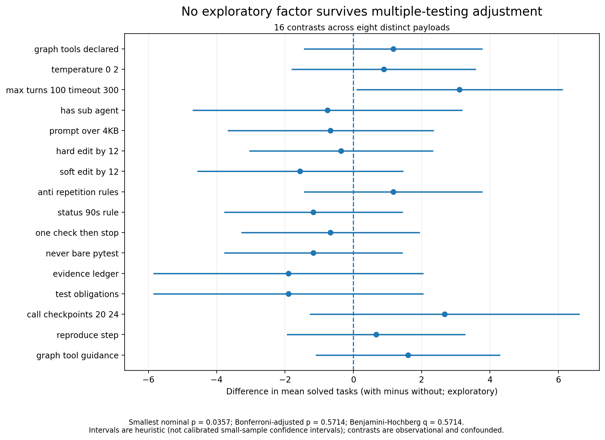
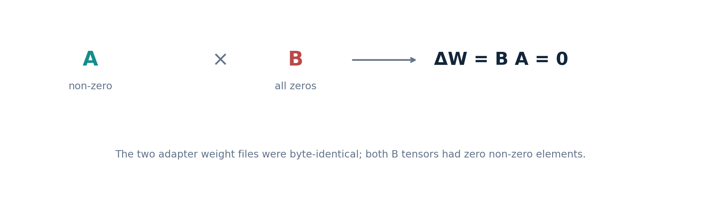

# The ZIP Is the Treatment
## An artifact-first audit of repeated coding-agent submissions, configuration claims, and evidence quality in the Gemma 4 Developer Agent Competition

**Author:** Chukka Venugopalam  
**Track:** Google - The Gemma 4 Developer Agent Paper Track  
**Research cutoff:** 11 November 2026  
**Artifact:** Agent Submission Forensics Audit (ASFA), included with this paper

---

### Abstract

Leaderboard gains are often attributed to configuration edits, but aggregate scores alone cannot support that claim when artifacts repeat and outcomes vary. We audit 14 scored Gemma 4 Developer Agent submissions using archive and member hashes, configuration extraction, and SafeTensors inspection. The archives contain 12 distinct payloads. Three submissions with the same extracted baseline payload scored 0.15, 0.17, and 0.20. Under the participant-derived 58-task interpretation, these are 9, 10, and 12 solved tasks. Ten records in the 28-call/eight-minute/4,096-thinking envelope averaged 9.0 solves; nine used 8,192 output tokens and one used 16,384. Four records outside it averaged 2.5, but their settings are confounded. In 16 exploratory factor contrasts over eight payloads, 15 heuristic intervals spanned zero; the remaining contrast bundled two settings and was uncorrected. Two later single-factor trials scored 0.12 (output cap doubled) and 0.15 (thinking budget halved). A two-adapter package contained byte-identical adapters with zero-valued LoRA B matrices, yielding no effective update. We release a tested, standard-library audit tool and evidence ledger. We do not claim a better agent or causal setting effect; we show how to make leaderboard evidence auditable.

**Keywords:** software engineering agents; reproducibility; benchmark variance; artifact forensics; Gemma 4; LoRA audit; leaderboard evaluation

---

## 1. Introduction

Repository-level software engineering is not ordinary code completion. A system must interpret an issue, locate relevant code, edit one or more files, preserve surrounding behavior, and produce a patch that passes tests. The Gemma 4 competition evaluates this end-to-end repair behavior on repository tasks. A leaderboard score is therefore an outcome of both the submitted agent and the evaluation process that executes it.

The competition reports an aggregate pass/fail patch metric [2]. This score does not reveal which tasks passed, why patches failed, or whether two submissions contain identical files. The Paper Track explicitly values verifiability alongside novelty, quality, relevance, and clarity [1].

This paper asks a narrower question than “Which prompt is best?”: **When a participant compares scored ZIP submissions, what can the submitted artifacts and aggregate outcomes actually support?** Our case study began with 14 historical ZIPs and continued with two later, single-setting experiments. Rather than infer a causal winner from the highest observed score, we audit package identity, configuration, adapter contents, and provenance.

We contribute an artifact-identity analysis, repeated-outcome and confounding audit, a numerical check of adapter validity, and an open standard-library tool for hashes, duplicate groups, score bounds, and evidence provenance.

*Figure 1. Artifact-first audit pipeline. The canonical payload fingerprint excludes ZIP container metadata.*

## 2. Related work

SWE-bench established issue-level patch application and test verification as a benchmark pattern [4]. SWE-agent studies how an agent-computer interface shapes tool-mediated repository work [5]. Agentless offers a contrasting staged localization, repair, and validation workflow, showing that a more complex autonomous loop is not automatically necessary [6]. Competition-specific analyses have documented evaluator-version changes and repeated-bundle uncertainty [7]; a public configuration-draw dataset also groups scored versions by file-content hashes [8]. We do not claim to be first to observe score variation or hash-identical submissions. Our contribution is to join archive identity, configuration extraction, adapter validity, and evidence provenance in one reproducible audit workflow.

## 3. Questions and scope

We examine four retrospective questions:

- **RQ1 - Identity:** How many distinct agent payloads are represented by 14 scored archives?
- **RQ2 - Repeatability:** What score spread is observed when the same payload is submitted more than once?
- **RQ3 - Attribution:** Do the historical configuration comparisons isolate a factor that consistently improves the score?
- **RQ4 - Implementation validity:** Did the adapter-augmented package contain a non-zero learned parameter update?

The primary unit is a scored archive; distinct extracted payloads prevent repeated copies being counted as independent designs. Private task outcomes and execution traces were unavailable.

## 4. Data and methods

### 4.1 Submission corpus

The primary corpus is 14 participant-supplied ZIP archives labeled with public scores from 0.00 to 0.20. Each archive was inspected without modifying its contents. The supplied forensic manifest records the model, declared tools, optional graph tools, sub-agent and adapter counts, sampling parameters, task budgets, prompt size, archive hash, and normalized content fingerprint. These configurations were not randomized.

Kaggle's official overview defines the score as the percentage of patched repositories whose validation tests pass [2]. The public denominator is not stated in that overview. A participant discussion reconstructs 58 public tasks from the leaderboard's score lattice and reports that displayed scores are truncated to two decimals [3]. We therefore use 58 only as a **participant-derived interpretation**, not as an official denominator. Under this interpretation, scores of 0.15, 0.17, and 0.20 correspond to 9, 10, and 12 tasks respectively. All conclusions that depend on exact task counts inherit this caveat.

### 4.2 Artifact identity

A ZIP's SHA-256 is necessary but insufficient for identifying an agent payload: ZIP metadata can change while the contained files remain identical. We therefore computed both (a) the raw archive SHA-256 and (b) a canonical payload fingerprint. The latter sorts regular member paths and hashes each path, byte length, and member SHA-256, excluding ZIP timestamps and compression metadata. Two archives are treated as the same payload only when their canonical member manifests match. This rule is stricter than comparing filenames or visible YAML values.

### 4.3 Configuration and factor analysis

We extracted settings from `agent.yaml`, sampling configuration, and evaluation configuration. We grouped historical records by a core execution envelope of 28 tool calls, eight minutes, and 4,096 thinking tokens; nine of its ten records used 8,192 output tokens and one adapter-augmented record used 16,384. Within this envelope, we repeated 16 exploratory binary-factor contrasts across eight distinct payloads. The plotted intervals are heuristic normal intervals using the observed archive-level run SD as a plug-in scale; they are not calibrated confidence intervals because the sample is tiny and payload-level dependence is present. Fifteen span zero; the one marginal bundled contrast is described in Section 5.3. Factor assignments were participant-selected, settings covary, and the comparisons are not randomized or pre-registered. Nominal permutation p-values are descriptive, not causal evidence.

### 4.4 Follow-up one-factor trials

After the original forensic analysis, two variants were submitted separately from the original baseline: I02 changed only `max_output_tokens` from 8,192 to 16,384; B2 changed only `thinking_budget` from 4,096 to 2,048. We matched each uploaded scored archive to its experiment ZIP by SHA-256. Their observed public scores were 0.12 and 0.15, respectively. Each is one submission, not a replicated estimate of an arm's mean.

### 4.5 Adapter audit, harness audit, and evidence grading

We loaded the two adapter SafeTensors files and inspected tensor shapes and non-zero counts. Both adapter files were byte-identical. For both adapters, the two LoRA B matrices contained zero non-zero elements. Under standard LoRA parameterization, the update is \(\Delta W = B A\), so these matrices produce a zero update regardless of the non-zero A matrices. This establishes that the package did not test the benefit of trained LoRA weights.

We label evidence as **observed** (directly inspected archive or Kaggle score), **derived** (deterministic transformation of observed data), **external** (published by another source), **inference** (plausible explanation), or **unknown**. This prevents synthetic test success, public aggregate scores, or repository-derived metadata from being mistaken for live agent execution.

## 5. Results

### 5.1 Fourteen archives, twelve payloads

The 14 scored archives reduce to 12 distinct payloads. The 0.17 and 0.20 archives are byte-identical ZIPs. The 0.15 archive has a different ZIP-level hash but the same four extracted files and member hashes. Thus, one effective agent payload produced three recorded outcomes: 9, 10, and 12 solved tasks (participant-derived 58-task mapping), with a mean of 10.33 and a range of three tasks (Figure 2). This directly shows that the best single observed result is not a stable estimate of the payload's expected score. The cause of the spread is unresolved: the archive evidence alone cannot distinguish model sampling, infrastructure, task-level nondeterminism, or scorer changes.

| Payload / arm | Records | Public score(s) | Solves (58-task interpretation) | Reading |
|---|---:|---:|---:|---|
| Original baseline payload | 3 | 0.15 / 0.17 / 0.20 | 9 / 10 / 12 | Same four files; variable outcomes |
| I02: output cap 16,384 | 1 | 0.12 | 7 | Single run; no demonstrated benefit |
| B2: thinking budget 2,048 | 1 | 0.15 | 9 | Single run; no demonstrated benefit |

*Figure 2. The same extracted baseline payload produced three different public scores. I02 and B2 are single observations, not arm means.*

### 5.2 The apparent runtime-regime effect is confounded

Ten archive records match the core 28-call/eight-minute/4,096-thinking envelope; nine have an 8,192-token output cap and one adapter-augmented record has 16,384. Their scores correspond to 12, 11, 11, 10, 9, 8, 8, 7, 7, and 7 solves: mean 9.0, standard deviation 1.89. Four out-of-regime archives correspond to 0, 2, 4, and 4 solves: mean 2.5 (Figure 3). The 6.5-task descriptive gap is large, but the four low-scoring records also change other settings: thinking is absent in three, and skills or sub-agents occur in three. The data cannot identify the regime settings as the cause. We retain this result as a warning not to leave the established configuration casually, not as a causal estimate of the time budget.

*Figure 3. The core envelope fixes tool calls, time and thinking; output cap is 8,192 in nine records and 16,384 in one. The between-group gap is descriptive, not causal.*

### 5.3 No small factor is established inside the core envelope

Across eight distinct payloads in the core envelope, 15 of 16 heuristic normal intervals include zero (Figure 4). The sole interval that narrowly excludes zero is the bundled combination of 100 turns and a 300-second command timeout (+3.11 solves, heuristic interval approximately +0.09 to +6.13; exact nominal permutation p=0.0357). It is based on only two payloads in the “with” group and changes two settings together. Because 16 exploratory contrasts were tested, we also adjust for multiple comparisons: the smallest Bonferroni-adjusted p-value is 0.5714 and the smallest Benjamini-Hochberg q-value is 0.5714. No contrast survives either adjustment at 0.05. These corrections do not remove confounding, feature dependence, or the limitations of eight payloads; the nominal signal is hypothesis-generating only. The intervals are not calibrated small-sample confidence intervals. Graph tools and temperature 0.2 show small positive point estimates, but their intervals also include zero. No factor has demonstrated a reliable improvement.

*Figure 4. Fifteen of 16 heuristic intervals cross zero; the one bundled contrast is only nominally positive and does not survive multiple-testing adjustment.*

### 5.4 Two one-factor follow-ups did not beat the baseline draw

The output-cap experiment scored 0.12 (7 tasks under the 58-task interpretation); the lower-thinking experiment scored 0.15 (9 tasks). Both are below the historical baseline's best draw of 0.20 (12 tasks). These observations do not prove that either setting is harmful: one run per arm is too little to estimate an expected score, and the same baseline payload itself ranged from 9 to 12 tasks. They do show that neither proposed mechanism has yet produced positive evidence. We therefore reject both as demonstrated improvements.

### 5.5 The adapter experiment was a null update

The 0.13 adapter package contained two identical adapter files, each 217,672 bytes. Each exposed four tensors targeting layer 0. The two A matrices were non-zero, but both B matrices had zero non-zero elements; consequently, \(BA=0\) (Figure 5). The score of this package cannot be interpreted as a test of effective LoRA fine-tuning. It is instead a failed experimental implementation: the intended treatment was absent.

*Figure 5. Standard LoRA update is zero when B is zero, even if A is non-zero.*

### 5.6 The harness contract exposes a redundant recovery instruction

The baseline prompt tells the agent to run `git checkout` on protected test paths and call `submit_patch` again if the diff includes tests. The supplied official contract says those protected hunks are stripped automatically and a submitted patch is captured at call time; the loop then exits after the current turn. The manual checkout therefore has no documented grading benefit and consumes a counted command. This is a contract-level inefficiency, not evidence that removing it improves score.

### 5.7 Repository intelligence was not source-verified

The M3 repository-intelligence package records that no official source snapshot was available for any of the 129 development tasks; its 694-row symbol index and task-to-symbol links are patch-derived, not verified against source trees. The M4 runtime audit's 19 passing tests exercised synthetic fixtures, not live Gemma episodes. We therefore exclude these outputs from performance claims. They remain useful evidence of why provenance labels belong in an agent-research workflow.

## 6. Discussion

The central finding is methodological: **a scored ZIP is not a sufficient experimental record unless tied to exact content, evaluation context, and run identity.** A high score can be a favorable draw; a lower score from the same payload need not indicate regression. A configuration diff also does not prove the intended intervention was applied: the zero-update adapter is a concrete example.

This complements prior work on repository-level agents. SWE-agent emphasizes the agent-computer interface [5], while Agentless shows that more autonomous complexity is not automatically better [6]. Contemporary participant analyses of this competition have also documented same-package score variation and evaluator-version concerns [7], as well as a public configuration-draw dataset that groups scored versions by file-content hashes [8]. Our resource extends the artifact-level view with a compact, reusable audit of configuration files, score-to-task interpretation, duplicate payloads, and implementation-level adapter validity. We do not claim to be the first to observe score variation or content-hash repeats.

For future experiments: freeze and hash a baseline; register one change and its expected mechanism; hash each candidate and record the scorer date; repeat control and treatment; preserve per-task outcomes and tool traces; and promote a change only after a practically meaningful repeated improvement. Without task-level traces, report aggregate single-draw observations.

## 7. Limitations

This single-participant case study has 14 historical archives and two later one-factor trials. Settings were not randomized; the repeated payload has only three observations; 58 tasks is participant-derived; and task outcomes, traces, serving logs, and evaluator deployment receipts were unavailable. Aggregate scores cannot attribute failures. We cannot estimate expected solve rate, causal effects, or private ranking. M3/M4 audits do not close these gaps. ASFA is a forensic aid, not an evaluator or model-improvement method.

## 8. Conclusion

The best observed score in this case study was 0.20, but the same extracted agent payload also scored 0.15 and 0.17. Two subsequent single-change trials scored 0.12 and 0.15. No tested configuration change has established a repeatable uplift. The adapter experiment did not apply a non-zero LoRA update. These are not failures of reporting; they are the findings. We release an artifact-first audit toolkit to make future coding-agent comparisons harder to misinterpret. For a field that measures autonomous software engineering through hidden tests, reproducibility begins before model inference: it begins with knowing exactly what was submitted and what the observed score can support.

## References

[1] Google DeepMind. *Google - The Gemma 4 Developer Agent Paper Track: Overview and Evaluation*. Kaggle, 2026. https://www.kaggle.com/competitions/gemma-4-developer-agent-paper/overview/evaluation

[2] Google DeepMind. *Google - The Gemma 4 Developer Agent Competition: Overview*. Kaggle, 2026. https://www.kaggle.com/competitions/gemma-4-developer-agent

[3] G. Yeo. *The public leaderboard has exactly 58 tasks*. Kaggle discussion, 2026. Participant-derived reconstruction; not an official denominator disclosure. https://www.kaggle.com/competitions/gemma-4-developer-agent/discussion/743506

[4] C. E. Jimenez, J. Yang, A. Wettig, S. Yao, K. Pei, O. Press, and K. Narasimhan. “SWE-bench: Can Language Models Resolve Real-World GitHub Issues?” arXiv:2310.06770, 2023. https://arxiv.org/abs/2310.06770

[5] J. Yang, C. E. Jimenez, A. Wettig, K. Lieret, S. Yao, K. Narasimhan, and O. Press. “SWE-agent: Agent-Computer Interfaces Enable Automated Software Engineering.” arXiv:2405.15793, 2024. https://arxiv.org/abs/2405.15793

[6] C. S. Xia, Y. Deng, S. Dunn, and L. Zhang. “Agentless: Demystifying LLM-based Software Engineering Agents.” arXiv:2407.01489, 2024. https://arxiv.org/abs/2407.01489

[7] P. Kim. *Gemma 4 Developer Agent, Part 2: Measuring an Agent While Its Evaluator Moved*. Pilkwang's Bagel&Coffee, 23-24 October 2026. https://pilkwangkim.github.io/posts/Gemma-4-Developer-Agent-Part-2-Measuring-an-Agent-While-Its-Evaluator-Moved/

[8] D. Afshar. *Gemma 4 Agent: Public Config Draws*. Kaggle dataset and companion notebook, 2026. https://www.kaggle.com/datasets/dariushafshar/gemma-4-agent-public-config-draws

---

## Reproducibility note

The companion Agent Submission Forensics Audit (ASFA) release includes the archive-audit CLI, a machine-readable 14-record submission dataset, 12-payload deduplication table, eight-payload factor matrix, follow-up trial records, multiple-testing-adjusted contrasts, data card, schemas, unit tests, and a runnable synthetic demo. The self-contained notebook reproduces the summary analysis without network access or private archives. The resource contains no hidden test data, task snapshots, or model weights. It does not run Gemma, reproduce hidden tests, or infer private leaderboard outcomes.
