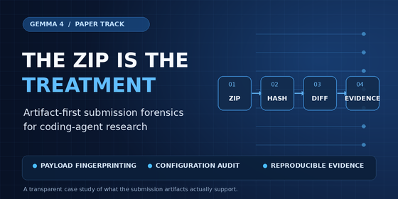

# The ZIP Is the Treatment: Gemma 4 Agent Submission Forensics

**Artifact-First Submission Forensics Audit (ASFA)** is a reproducible companion resource for the Gemma 4 Developer Agent Paper Track paper, *The ZIP Is the Treatment*.

The project audits scored agent-submission ZIPs before treating leaderboard differences as evidence about configuration changes. It fingerprints extracted ZIP payloads, extracts declared configuration, summarizes a small observational submission corpus, and inspects SafeTensors LoRA tensors for zero-valued update matrices.



> **Scope:** This is a single-participant forensic case study. It is not a new coding agent, a reproduction of Kaggle's hidden evaluator, or evidence of a causal performance improvement.

## Paper

- Manuscript: [`Gemma4_PaperTrack_Submission.md`](Gemma4_PaperTrack_Submission.md)
- PDF: [`paper/Gemma4_PaperTrack_Submission.pdf`](paper/Gemma4_PaperTrack_Submission.pdf)
- Editable DOCX: [`paper/Gemma4_PaperTrack_Submission.docx`](paper/Gemma4_PaperTrack_Submission.docx)

## Main findings

- Fourteen scored submission archives reduced to **12 distinct extracted payloads**.
- The same baseline payload appeared with three public scores: **0.15, 0.17, and 0.20**. The source of this variation is unknown.
- Under a participant-derived 58-task score interpretation, the baseline observations correspond to 9, 10, and 12 solves. **58 is an assumption, not an official denominator statement.**
- Ten records matched the 28-tool-call / 8-minute / 4,096-thinking envelope. Nine had an 8,192-token output cap and one had 16,384.
- Two later one-factor submissions scored 0.12 (output cap 16,384) and 0.15 (thinking budget 2,048). Each is one observation, not an estimate of an expected score.
- The inspected adapter package had zero-valued LoRA-B matrices, so its standard LoRA update was zero. This applies to that package only.
- Across 16 exploratory factor contrasts, the lowest nominal exact-permutation p-value was 0.0357; after Bonferroni and Benjamini–Hochberg adjustment, both values were 0.5714. No contrast survives correction.

All configuration contrasts are observational and confounded. The paper does not claim a causal setting effect or a superior agent.

## Repository layout

```text
.
├── Gemma4_PaperTrack_Submission.md
├── paper/                  # PDF and editable DOCX exports
├── assets/                 # Kaggle cover thumbnail
├── figures/                # Five figures used by the manuscript
├── notebooks/              # Self-contained Kaggle/Colab notebook
├── audit_tool/
│   ├── afsa.py             # ZIP identity + config inventory CLI
│   ├── analyze_case_study.py
│   ├── lora_audit.py       # Standard-library SafeTensors inspection
│   ├── data/               # Aggregate case-study data and demo manifest
│   ├── examples/           # Synthetic demo ZIP
│   └── tests/              # Unit tests
├── research_dataset/       # CC BY 4.0 dataset, data card, schemas, notebook, tests
├── releases/               # Standalone dataset + audit-tool release ZIP
├── analysis/               # Recomputed descriptive summary
└── docs/                   # Evidence ledger, figure notes, Kaggle + GitHub guides
```

## Requirements

- Python 3.10 or later
- No third-party Python packages for the CLI tools or tests
- Jupyter/Kaggle Notebook to run the notebook interactively

## Quick start

From the repository root:

```bash
cd audit_tool
python -m unittest discover -s tests -v
python analyze_case_study.py
python afsa.py examples/demo_manifest.csv \
  --archive-root examples/demo_archives \
  --out ../analysis/demo_audit_out \
  --tasks 58
```

The demo ZIP is synthetic. Its purpose is to demonstrate the CLI, not to represent a real scored submission.

### Audit your own submission ZIPs

Create a CSV with two columns, `archive,score`, and place the named ZIPs in a directory. Then run:

```bash
python audit_tool/afsa.py path/to/manifest.csv \
  --archive-root path/to/archives \
  --out audit_out \
  --tasks 58
```

The task count and score-display rule must be checked for the target competition. The `--tasks 58` value is used only to reproduce this case study's participant-derived interpretation.

### Inspect LoRA adapters

```bash
python audit_tool/lora_audit.py path/to/submission.zip   --out audit_out/lora_audit.json
```

The inspector reads supported SafeTensors dtypes using Python's standard library. It does not load a model or test adapter behavior in inference.

## Reproducible notebook

Open [`notebooks/ASFA_Reproducible_Audit.ipynb`](notebooks/ASFA_Reproducible_Audit.ipynb) in Kaggle or Jupyter. The v1.1 notebook embeds aggregate tables, recomputes 16 exploratory contrasts with Bonferroni and Benjamini–Hochberg adjustments, and includes a synthetic ZIP example. It does not require network access or private source archives. The standalone resource release is [`releases/ASFA_Public_Research_Dataset_and_Tool_v1_1.zip`](releases/ASFA_Public_Research_Dataset_and_Tool_v1_1.zip).

## Data provenance and limitations

- `audit_tool/data/archive_observations.csv` is an aggregate manifest derived from the participant's 14 scored archives. Raw submission ZIPs are not redistributed.
- The score-to-solve conversion assumes 58 tasks and floor-truncated two-decimal scores. This is not asserted as official competition documentation.
- `factor_features.csv` contains eight distinct payload-level groups. It is a small observational dataset, not a randomized experiment.
- The reported intervals are heuristic and are not calibrated small-sample confidence intervals.
- The notebook and CLI reproduce artifact analysis, not Gemma inference, Kaggle sandbox execution, hidden-task outcomes, or leaderboard results.
- Synthetic unit tests validate the audit utilities only.

See [`docs/EVIDENCE_LEDGER.md`](docs/EVIDENCE_LEDGER.md) for claim-by-claim provenance and limitations.

## License

The original code, documentation, and figures in this repository are provided under Apache-2.0. Competition-derived observations remain subject to applicable Kaggle competition terms and any rights governing the underlying data. See [`LICENSE`](LICENSE).

## Citation

The repository includes [`CITATION.cff`](CITATION.cff). Please cite the accompanying paper, *The ZIP Is the Treatment*, when using ASFA in research.
